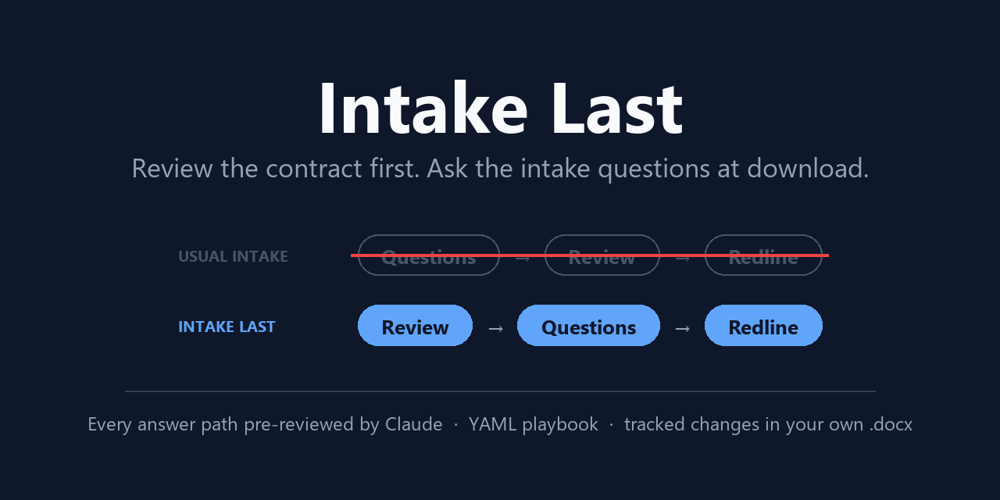

# Intake Last



Contract intake turned around. The business user submits the vendor's contract and nothing else. The contract is reviewed against the playbook right away, in every version the intake answers could call for. The intake questions come at the end, when the user wants the document. Their answers pick the version they download.

Traditional intake asks the questions first, and people skip the form. Here the review happens whether or not anyone answers, and the questions are the last step before the download.

## How it works

1. **Submit.** Upload a `.docx` or `.txt` with a name and email. No intake form.
2. **Review every version up front.** The playbook (`playbook/vendor-saas.yaml`) has *questions* (business language) and *positions* (one per contract topic). Each position lists *cases* keyed to answers, for example "liability cap if spend is under $25k and no personal data". Each case is reviewed against the contract once, as a set of small edits pinned to paragraphs. 10 positions produce 17 variants, not 2^n whole documents.
3. **Bring them back.** When the review finishes, the submitter gets one email: their contract is ready, answer N quick questions to download it, with a link straight to the questions. This is the moment they are motivated, so this is when the questions are asked.
4. **Ask only what matters.** A question is skipped if no answer to it would change the redline for *this* contract (for example the contract already meets every renewal position). Questions with an escalating answer are always asked. `show_if` hides follow-ups that don't apply.
5. **Deliver.** The user's answers pick one case per position. The edits are written into the user's **original** .docx as real tracked changes with a margin comment on each, so numbering, styles, fonts, tables, headers and footers are untouched. Only the runs an edit touches are rewritten, and they keep their formatting. (.txt uploads get a freshly built Word file.) Escalations (deal over $250k, sensitive data) tell the user to send it to Legal or Privacy. If two topics edit the same words, the first wins and the conflict is flagged.

A **lawyer view** (`#/m/<id>/lawyer`) shows every pre-reviewed case and its edits.

## Run it

```
npm install
npm run mock     # demo mode: keyword-based stand-in reviewer, no API key needed
npm start        # live: Claude (claude-opus-5-5) reviews each variant
npm test
```

Open http://127.0.0.1:3330. For live mode set `ANTHROPIC_API_KEY` or add the key in Settings (saved to `data/settings.json`).

Ready emails go through [Resend](https://resend.com) when `RESEND_API_KEY` is set (env or Settings), from `EMAIL_FROM` (default `onboarding@resend.dev`, which Resend only delivers to your own account address until you verify a domain), with links built from `APP_URL` (default the local server). Without a Resend key, emails are kept in `data/outbox/` and shown on the in-app **Outbox** page, so nothing is sent during development. The same variable names as CLE Sweeper. `samples/` has a fictional, vendor-friendly SaaS agreement as plain .docx and as a formatted .docx (auto-numbering, bold defined terms, a table, header and footer), plus an example redline of the formatted one from a live run. `npm run sample` rebuilds them from the `.txt`.

## Layout

- `playbook/vendor-saas.yaml`: questions and positions. Drafted by Claude and reviewed by the playbook owner on 2026-10-17. Governing law is deliberately not covered.
- `server/playbook.js`: loads and validates the playbook, resolves answers to cases.
- `server/review.js`: one Claude call per case (contract cached across calls), structured output, edits validated against the real text.
- `server/assemble.js`: picks cases from answers, merges edits, decides which questions to ask.
- `server/docxml.js`: paragraph and run model of WordprocessingML, plus computed list numbers ("8.1") so the reviewer sees section numbers that Word only adds on screen.
- `server/patch.js`: writes tracked changes and comments into the original .docx.
- `server/docx.js`: builds a new .docx for .txt uploads.
- `server/notify.js`: the ready email (Resend or local outbox).
- `data/matters/`: one JSON file per submitted contract (gitignored).

## Known limits (v0.3)

- Text inside text boxes is not reviewed. Contracts that already carry someone else's tracked insertions are reviewed as if those were accepted; editing inside one of them is not specially handled.
- List numbers are computed for direct numbering only; style-linked numbering and restart overrides are not modelled.
- Contracts submitted before v0.2 have no stored original and download as a rebuilt file.
- One email only: no reminder if the submitter never answers, and no email to Legal on escalations.
- Links in emails point at this machine unless `APP_URL` is set to where the app is hosted.
- Automated first-pass redline. Not legal advice.

## License

MIT. See [LICENSE](LICENSE).
